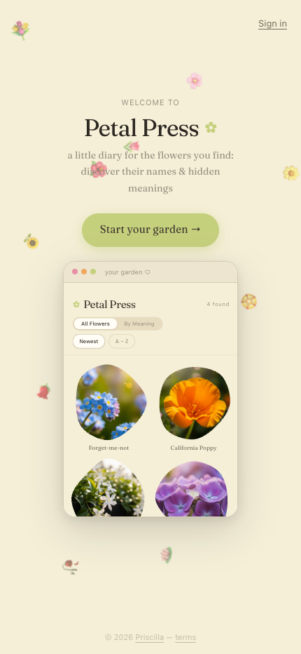
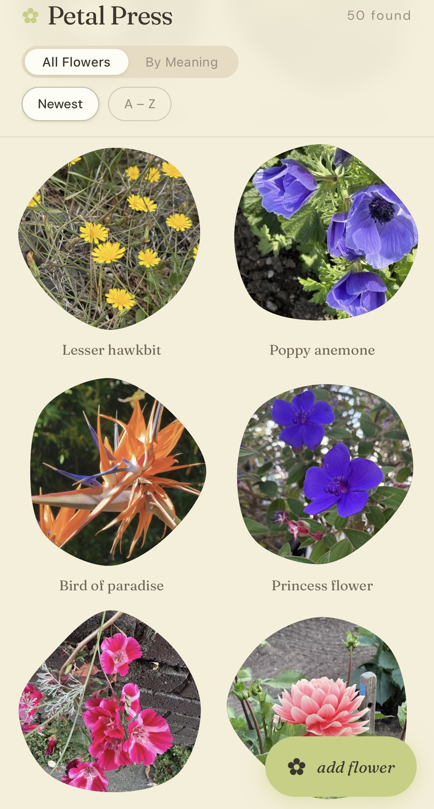

# Petal Press 🌸

A little diary for flowers. Photograph a flower on a walk, identify it, and uncover its hidden Victorian meaning (floriography) — then press it into your own garden index.

  
  

## Features

- **Capture flow** — snap or upload a photo, get identified via the Pl@ntNet API, confirm and save
- **Floriography** — every flower comes with its name, Latin name, and hidden meaning
- **Garden index** — grid of pressed flowers with color filters and a "discovered" counter
- **Shared species galleries** — multiple photos of the same species collect into one gallery
- **Sign-in** — magic link + OTP code
- **Admin dashboard** — total users, total flowers, per-user breakdown

## Stack

- **Frontend**: React + Vite, TypeScript, Tailwind CSS, Framer Motion
- **Backend**: Express API server, Drizzle ORM
- **Auth, database & storage**: Supabase
- **Flower identification**: Pl@ntNet API
- pnpm workspaces monorepo
